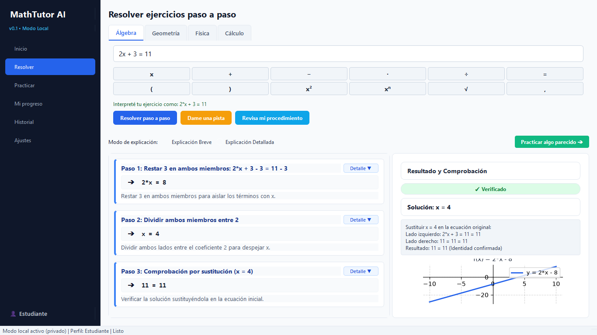

# MathTutor AI



Captura real incluida en el proyecto. Más capturas: [Inicio](screenshot_home.png) y [Práctica](screenshot_practice.png).

**Versión del paquete: 0.1.0.** Esta versión utiliza reglas pedagógicas y cálculo simbólico local; no integra un modelo de lenguaje ni requiere claves API.

**MathTutor AI** es una aplicación de escritorio nativa para Windows (11 / 10 x64) diseñada para ayudar a estudiantes de secundaria y primeros cursos universitarios a comprender conceptos matemáticos y científicos mediante transformaciones justificadas, revisión de procedimientos paso a paso, pistas didácticas y práctica adaptada a su desempeño.

---

## Características Principales

1. **Modo Local**:
   - Funciona sin conexión a internet obligatoria, sin registro, sin tarjeta ni credenciales de IA externas.
   - Perfil de usuario local ("Estudiante") personalizable sin recolección de datos personales.
   - Base de datos local SQLite en `%LOCALAPPDATA%/MathTutorAI/mathtutor.db`; la aplicación no cifra este archivo.

2. **Alcance Matemático y Científico (v0.1)**:
   - **Álgebra**: Ecuaciones lineales de una incógnita con paréntesis y fracciones racionales; ecuaciones cuadráticas con análisis de discriminante, factorización o fórmula general. Casos de infinitas soluciones y sin solución en $\mathbb{R}$.
   - **Geometría**: Teorema de Pitágoras (despeje de hipotenusa o catetos), área de triángulos, área y perímetro de rectángulos y círculos. Validación de dimensiones físicas reales ($> 0$).
   - **Física**: Movimiento Rectilíneo Uniforme ($d = v \cdot t$), Segunda Ley de Newton ($F = m \cdot a$) y conversiones entre unidades compatibles (ej. $\text{km/h} \leftrightarrow \text{m/s}$).
   - **Cálculo**: Derivadas e integrales indefinidas de funciones polinómicas de una variable con desglose por reglas de potencia, suma y constante arbitraria $+ C$.

3. **Resolver Enseñando**:
   - Cada solución desglosa: expresión anterior, operación aplicada, expresión resultante y explicación didáctica.
   - Selector de explicaciones en modo **Breve** o **Detallado**.
   - Comprobación final por sustitución simbólica en la ecuación original.
   - Modo guiado con botón *"Dame una pista"* para revelar pasos de forma progresiva.

4. **Revisión de Procedimientos del Alumno**:
   - Analizador línea a línea de ecuaciones para detectar y explicar transiciones erróneas (ej. error de signo al trasponer términos o errores de división).
   - Aceptación de procedimientos alternativos válidos y equivalentes (ej. multiplicar ambos miembros por un factor).

5. **Práctica Adaptativa y Progreso Real**:
   - Generador de ejercicios parametrizados con semilla (`seed`) reproducible y 3 niveles de dificultad por tema.
   - Heurística pedagógica: evaluación en bloques de 5 ejercicios resueltos sin pistas (4-5 aciertos sube de nivel, 3 mantiene, 0-2 desciende de nivel).
   - Reporte de estadísticas basado únicamente en datos reales de práctica.

6. **Validación de entradas**:
   - Analizador sintáctico seguro basado en AST (`safe_parser.py`) con lista blanca estricta de operadores y variables.
   - El parser construye expresiones mediante operaciones admitidas y limita longitud, profundidad y exponentes. Las pruebas cubren casos de inyección; no sustituyen una auditoría completa.

---

## Requisitos del Sistema

- **Sistema Operativo**: Windows 11 o Windows 10 (x64).
- **Python**: 3.10 o superior (desarrollado y probado en Python 3.14).
- **Librerías principales**: `PySide6` (Qt), `sympy`, `matplotlib`, `numpy`.
- Internet para descargar dependencias durante la instalación inicial. Después, la aplicación funciona localmente.

## Instalación desde cero

En PowerShell:

```powershell
git clone https://github.com/HexNomad23/MathTutor-AI.git
cd MathTutor-AI
python -m venv .venv
.\.venv\Scripts\python.exe -m pip install -r requirements.txt
.\.venv\Scripts\python.exe -m mathtutor.main
```

También puedes descargar y extraer el ZIP del repositorio, abrir PowerShell en la carpeta que contiene `pyproject.toml` y ejecutar los tres últimos comandos. Un repositorio privado requiere acceso a la cuenta o al repositorio.

No es necesario activar el entorno ni cambiar la política de ejecución de PowerShell. Cada computadora debe crear su propio `.venv`: los entornos copiados pueden apuntar al Python de otro usuario.

### Dependencias de ejecución y desarrollo

La fuente de dependencias es [`pyproject.toml`](pyproject.toml). `requirements.txt` instala el proyecto; `requirements-dev.txt` lo instala en modo editable con el extra de desarrollo, sin duplicar las listas de dependencias.

| Dependencia | Mínimo declarado | Uso |
| --- | --- | --- |
| PySide6 | 6.5.0 | Interfaz gráfica Qt. |
| SymPy | 1.12 | Cálculo simbólico y comprobaciones. |
| Matplotlib | 3.8.0 | Gráficas integradas en Qt. |
| NumPy | 1.23.2 | Evaluación numérica de gráficas. |
| pytest | 7.0.0 | Pruebas; extra `dev`. |
| PyInstaller | 6.0.0 | Compilación portable; extra `dev`. |
| setuptools | 61.0 | Backend de construcción. |

SQLite, `ast`, `json` y las demás utilidades estándar utilizadas vienen con Python. Pip resuelve las dependencias transitivas.

Para preparar el desarrollo:

```powershell
.\.venv\Scripts\python.exe -m pip install -r requirements-dev.txt
.\.venv\Scripts\python.exe -m pytest -q
.\.venv\Scripts\python.exe -m pip check
```

[`requirements-lock-windows-py314.txt`](requirements-lock-windows-py314.txt) conserva las versiones exactas del entorno de validación en Windows con Python 3.14.7. Es una instantánea de paquetes sin hashes, específica de ese entorno. Para reproducirlo en un `.venv` nuevo:

```powershell
.\.venv\Scripts\python.exe -m pip install -r requirements-lock-windows-py314.txt
.\.venv\Scripts\python.exe -m pip install --no-deps --no-build-isolation -e ".[dev]"
```

---

## Instrucciones de Uso

### 1. Ejecutar desde el código fuente
Después de instalar las dependencias, para iniciar la aplicación:
1. Haz doble clic en el script lanzador:
   ```cmd
   iniciar_app.bat
   ```
   o bien desde PowerShell:
   ```powershell
   .\.venv\Scripts\python.exe -m mathtutor.main
   ```

### 2. Ejecutar las pruebas automatizadas
Para validar todos los módulos y la suite completa de pruebas de aceptación:
```powershell
.\.venv\Scripts\python.exe -m pytest -q
```

Validación de esta publicación (15 de octubre de 2026, Windows, Python 3.14.7): **31 pruebas aprobadas** y `pip check` sin dependencias incompatibles. La suite de interfaz utiliza Qt en modo `offscreen`; este resultado no equivale a probar el ejecutable en una instalación limpia de Windows.

### 3. Compilar la distribución portable para Windows
Para generar la versión portable ejecutable (`MathTutorAI.exe`), instala primero las dependencias de desarrollo:
1. Ejecuta el script:
   ```cmd
   scripts\compilar_exe.bat
   ```
2. La carpeta compilada se generará en:
   ```text
   dist/MathTutorAI/
     ├── MathTutorAI.exe
     └── ... (librerías y dependencias de Qt)
   ```

---

Distribuye **toda la carpeta `dist/MathTutorAI`**, incluidas las bibliotecas acompañantes. También puedes compilar desde PowerShell:

```powershell
.\.venv\Scripts\python.exe scripts\build_windows.py
```

La configuración alternativa portable está en `MathTutorAI.spec`:

```powershell
.\.venv\Scripts\python.exe -m PyInstaller --noconfirm MathTutorAI.spec
```

## Estructura del Proyecto

```text
MathTutorAI/
  ├── src/
  │   └── mathtutor/
  │       ├── core/           # Modelos de datos compartidos y estados de verificación
  │       ├── math_engine/    # Parser seguro y motores simbólicos (álgebra, geometría, física, cálculo)
  │       ├── tutor/          # Explicaciones pedagógicas y revisor de pasos
  │       ├── practice/       # Generador parametrizado y controlador adaptativo
  │       ├── storage/        # Persistencia SQLite local y perfiles
  │       ├── ui/             # Interfaz gráfica PySide6 (vistas, teclado, gráficas)
  │       └── main.py         # Punto de entrada de la aplicación
  ├── tests/                  # Suite completa de pruebas automatizadas (pytest)
  ├── scripts/                # Compilación PyInstaller y captura de pantalla
  ├── .gitattributes          # Finales de línea y archivos binarios
  ├── .gitignore              # Exclusiones de archivos locales y generados
  ├── MathTutorAI.spec        # Configuración portable de PyInstaller
  ├── iniciar_app.bat         # Lanzador directo de un solo clic
  ├── pyproject.toml          # Configuración de dependencias y empaquetado
  ├── requirements.txt        # Instalación de ejecución
  ├── requirements-dev.txt    # Instalación editable con herramientas de desarrollo
  ├── requirements-lock-windows-py314.txt # Versiones exactas de validación
  ├── screenshot_home.png     # Captura de Inicio
  ├── screenshot_practice.png # Captura de Práctica
  ├── screenshot_solver.png   # Captura de resolución mostrada en este README
  ├── MANDATO_MATHTUTOR.md     # Especificación original
  ├── PROGRESO_MATHTUTOR.md    # Registro original de seguimiento
  └── README.md               # Documentación general en español
```

Dentro de `ui/`, `views/` contiene las seis vistas y `widgets/` el teclado matemático, las tarjetas de pasos y las gráficas. `ui/main_window.py` conecta la navegación y `main.py` inicia la aplicación.

## Ejemplos de uso

1. En **Resolver → Álgebra**, introduce `2x + 3 = 11` y pulsa **Resolver paso a paso**. El resultado es `x = 4` con comprobación.
2. Usa **Dame una pista** para avanzar con ayuda o **Revisa mi procedimiento** para revisar tus ecuaciones intermedias.
3. Cambia a Geometría, Física o Cálculo para completar sus formularios específicos.
4. Practica por tema y consulta **Mi progreso** e **Historial**. Personaliza tu nombre en **Ajustes**.

| Entrada o problema | Resultado esperado |
| --- | --- |
| `3(x - 2) = 12` | `x = 6` |
| `x^2 - 5x + 6 = 0` | `x = 2` y `x = 3` |
| `x^2 + 1 = 0` | Sin soluciones reales |
| Pitágoras con catetos 3 y 4 | Hipotenusa 5 |
| MRU: 150 m en 10 s | 15 m/s |
| Conversión de 72 km/h a m/s | 20 m/s |
| Derivada de `3x^2 + 2x - 5` | `6x + 2` |
| Integral de `2x + 3` | `x^2 + 3x + C` |

## Datos, base de datos y respaldo

El código incluye el generador de ejercicios y la creación del esquema SQLite. No se necesita descargar un conjunto de datos ni configurar un servidor. El primer arranque crea la base y el perfil `Estudiante`.

La ruta habitual es `%LOCALAPPDATA%\MathTutorAI\mathtutor.db`. Si `LOCALAPPDATA` no existe, se utiliza `~/.mathtutor_ai/mathtutor.db`.

| Tabla | Contenido |
| --- | --- |
| `schema_version` | Versión del esquema y fecha de aplicación. |
| `profiles` | Nombre y preferencias del perfil. |
| `history` | Entradas, soluciones, pasos y comprobaciones. |
| `attempts` | Respuestas, semillas, dificultad, pistas y aciertos. |
| `topic_progress` | Nivel, contadores y bloque de adaptación por tema. |

El esquema y sus operaciones se encuentran en [`src/mathtutor/storage/database.py`](src/mathtutor/storage/database.py). Para respaldar o transferir el historial, cierra la aplicación y copia `mathtutor.db`. Para restaurarlo, con la aplicación cerrada, coloca la copia en esa misma ruta; conserva antes el archivo existente si contiene datos que quieras mantener.

El repositorio incluye las carpetas de código, pruebas y scripts, además de los documentos y las capturas del proyecto. `.gitignore` excluye datos personales de uso, credenciales, `.venv`, cachés, registros, accesos directos locales y los resultados generados `build/` y `dist/`. Las dependencias y distribuciones se reconstruyen con los comandos documentados. No se publica el historial personal de la computadora.

## Actualizar las capturas

Desde la raíz y con las dependencias instaladas:

```powershell
.\.venv\Scripts\python.exe scripts\capturar_pantalla.py
```

Este script abre la interfaz, utiliza una base en memoria con datos de demostración y sobrescribe los tres PNG. No utiliza el historial personal.

## Problemas frecuentes

- **No se encuentra Python:** instala Python de 64 bits y comprueba `python --version` en una nueva consola.
- **El entorno apunta a otro usuario:** crea un `.venv` nuevo en esta computadora; no reutilices el entorno copiado.
- **Falta `mathtutor` o una biblioteca:** instala desde la raíz del proyecto y utiliza el Python de `.venv` de los ejemplos.
- **El ejecutable copiado no arranca:** conserva toda la carpeta de distribución y sus bibliotecas.
- **Una expresión no se admite:** consulta el alcance de esta versión. No hay soporte general para cualquier problema o texto libre.

## Limitaciones y áreas a mejorar

Las siguientes son propuestas pendientes, no funciones disponibles:

| Prioridad | Área | Mejora propuesta |
| --- | --- | --- |
| Alta | Parser y rendimiento | Ampliar pruebas de expresiones anidadas y costo de cálculo, además de los límites actuales. |
| Alta | Pruebas automáticas | Incorporar integración continua, medición de cobertura y una matriz de versiones de Python y Windows. |
| Alta | Persistencia | Añadir pruebas de migración y restauración, y exportación/importación desde la interfaz. |
| Media | Matemáticas | Ampliar sistemas de ecuaciones, inecuaciones, trigonometría y cálculo no polinómico, con comprobaciones propias. |
| Media | Pedagogía | Enriquecer diagnósticos de errores y variedad de ejercicios; evaluar la adaptación con estudiantes. |
| Media | Accesibilidad | Revisar teclado, lectores de pantalla, contraste, escalas y recortes de textos o gráficas. |
| Media | Distribución | Automatizar releases y compilaciones; probar el portable en un Windows limpio y definir firma del ejecutable. |
| Media | Mantenimiento | Incorporar formateo, análisis estático y revisión del manejo de errores. |
| Pendiente | Licencia | Elegir una licencia explícita para el código y documentar la redistribución de dependencias. |

Las pruebas incluidas comprueban casos concretos; no garantizan corrección para cualquier expresión. Los hitos y resultados de `PROGRESO_MATHTUTOR.md` describen el registro original de desarrollo y se conservan como tal.

## Contribuir

Prepara el entorno de desarrollo, describe el problema con una entrada reproducible y ejecuta las pruebas antes de proponer cambios. Para ampliar un motor, añade resultados esperados y comprobaciones matemáticas. Mantén los datos personales y los archivos generados fuera de los commits.

## Créditos

- **Antigravity, con Flash 3.8 como agente**, por ayudar en el desarrollo de MathTutor AI.
- **GPT 6 Astra**, por ayudar en el desarrollo de MathTutor AI.
- A las comunidades de Python, Qt/PySide6, SymPy, NumPy, Matplotlib, pytest y PyInstaller por las herramientas utilizadas.

Los nombres de los asistentes se conservan según los créditos indicados por el responsable del proyecto. El código propio todavía no tiene una licencia explícita; las dependencias conservan sus respectivas licencias.
